# Tickets-module
Многомодульный Maven-проект для работы с билетами и перевозчиками на Spring Boot.

[](https://sonarcloud.io/dashboard?id=SokolovAndr_tickets-module)
[](https://sonarcloud.io/dashboard?id=SokolovAndr_tickets-module)

## 📋 Описание

Проект представляет собой модульное приложение на Java 17, построенное на Maven и Spring Boot 3.2.5.  
Основная бизнес-логика — управление билетами, маршрутами и перевозчиками.
Дополнительно реализован web-модуль с HTML-формами на Spring MVC + Spring Security.

> 🌐 **Production:** https://tickets-module-production.up.railway.app  
> 📄 **API Documentation (Swagger UI):** https://tickets-module-production.up.railway.app/swagger-ui/index.html

## 📸 Скриншоты

<table>
  <tr>
    <td style="text-align: center; width: 50%;">
      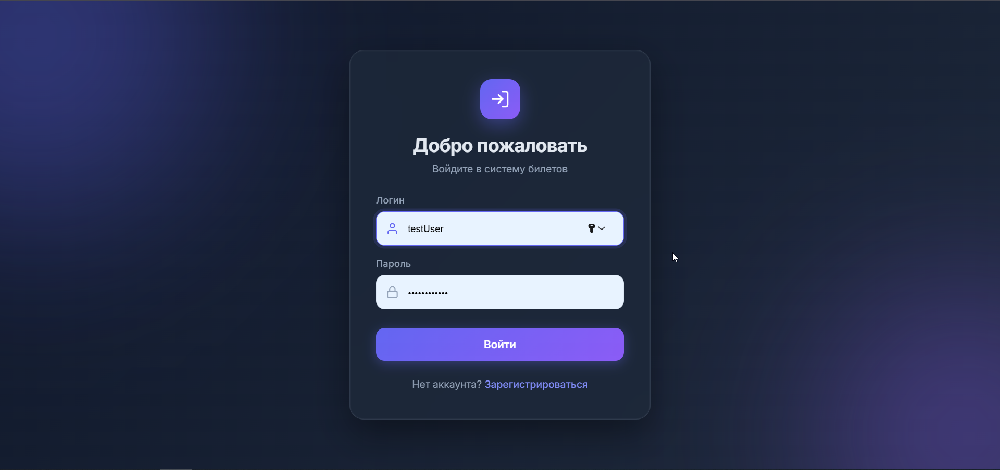
      <br/><b>Вход</b>
    </td>
    <td style="text-align: center; width: 50%;">
      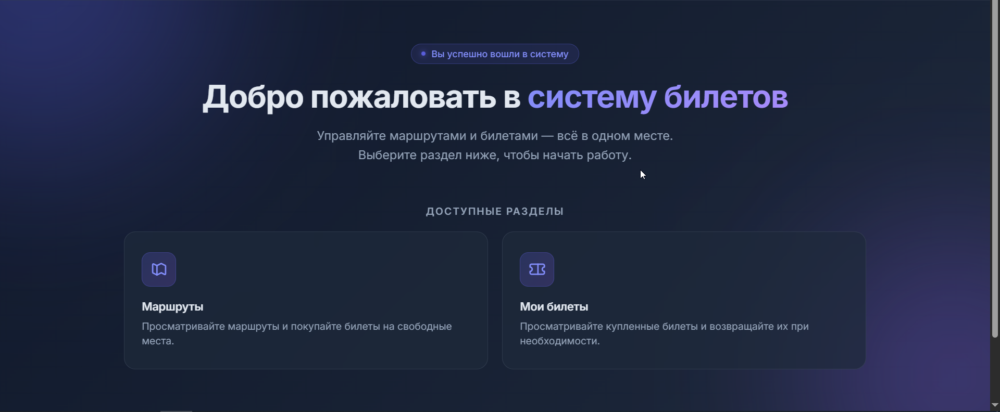
      <br/><b>Главная</b>
    </td>
  </tr>
  <tr>
    <td style="text-align: center; width: 50%;">
      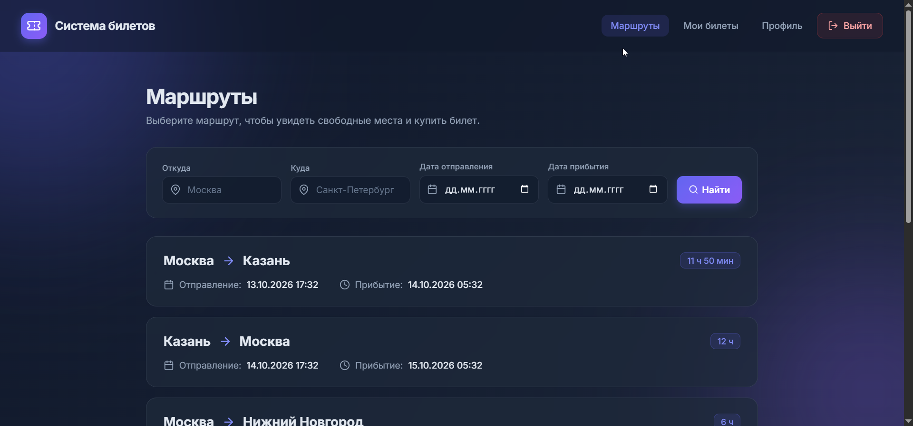
      <br/><b>Маршруты с поиском</b>
    </td>
    <td style="text-align: center; width: 50%;">
      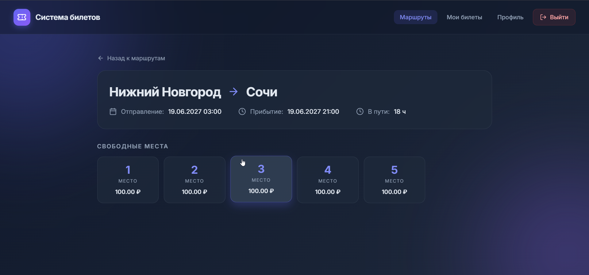
      <br/><b>Маршрут с билетами</b>
    </td>
  </tr>
  <tr>
    <td style="text-align: center; width: 50%;">
      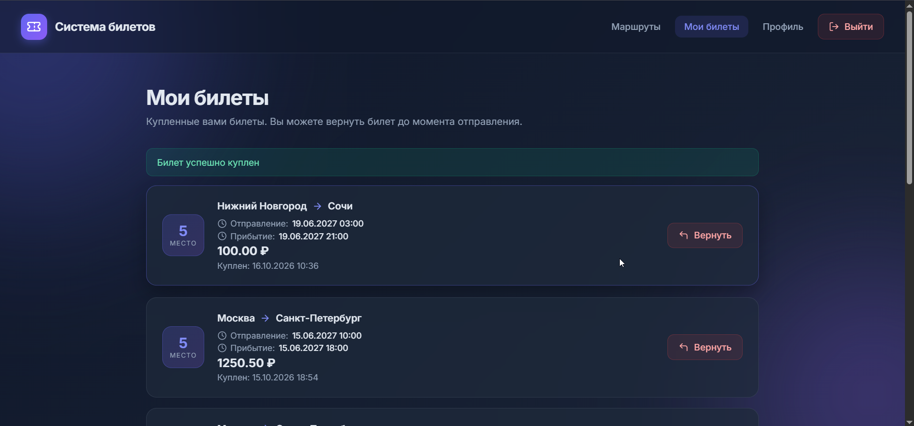
      <br/><b>Мои билеты</b>
    </td>
    <td style="text-align: center; width: 50%;">
      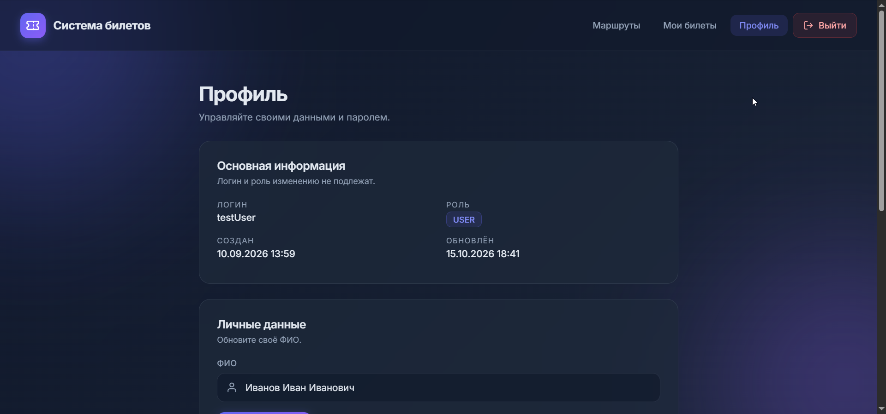
      <br/><b>Профиль</b>
    </td>
  </tr>
</table>

<p style="text-align: center;">
  <b>📱 Мобильная версия</b><br/>
  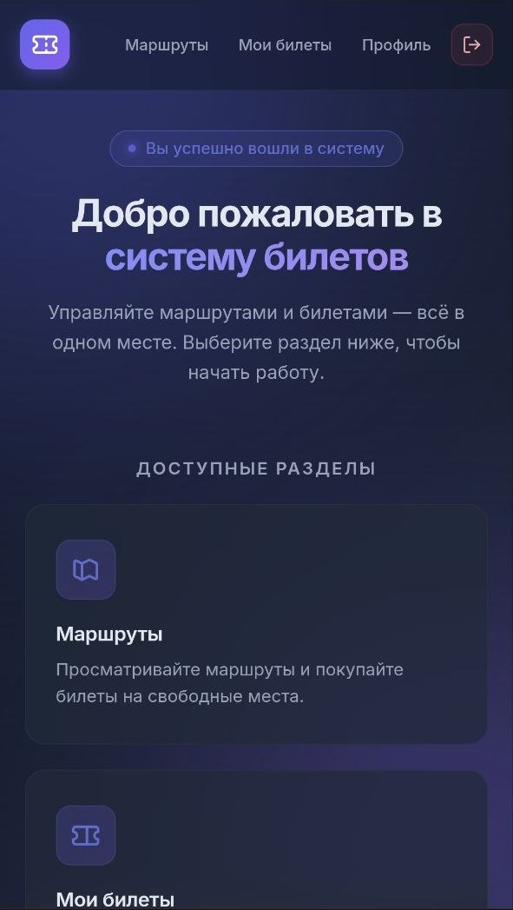
  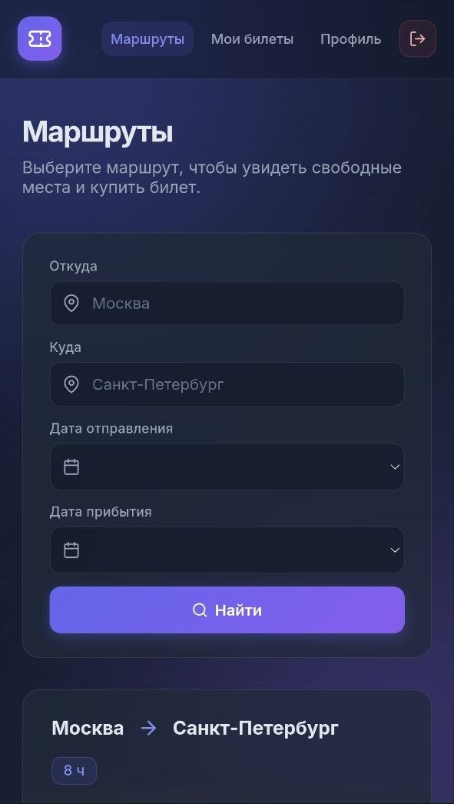
  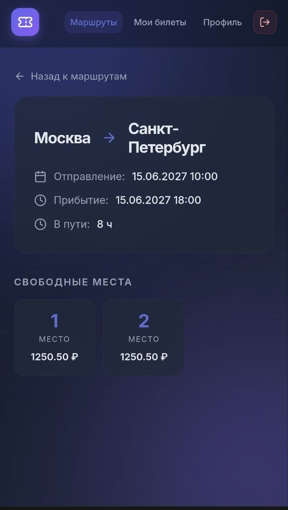
  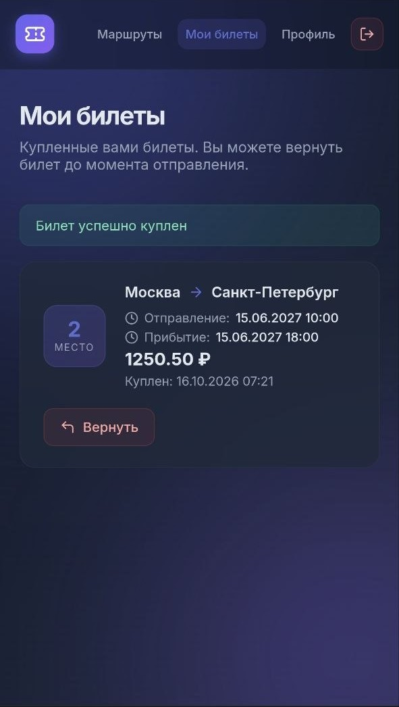
  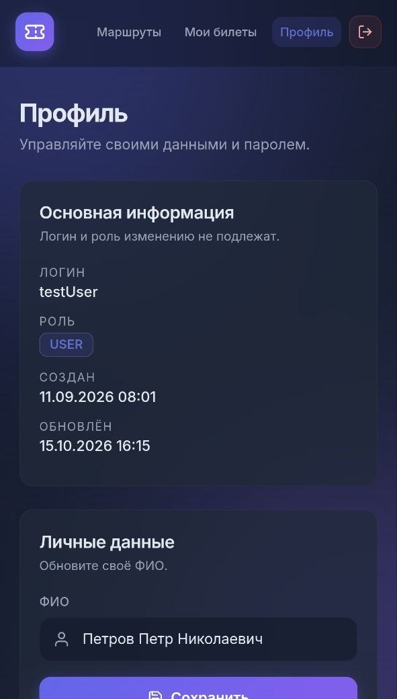
</p>

## 📦 Модули проекта

| Модуль | Назначение |
|--------|-----------|
| `coverage-report` | Агрегация отчётов JaCoCo из всех модулей для SonarCloud |
| `tickets-module-app` | Точка входа, конфигурация, интеграционные тесты |
| `tickets-module-web` | Web-слой: HTML-формы, Spring MVC-контроллеры |
| `tickets-module-impl` | Реализация бизнес-логики, UNIT тесты |
| `tickets-module-api` | Контракты REST API: DTO и интерфейсы контроллеров (генерируются из OpenAPI) |
| `tickets-module-db` | Только Liquibase-миграции (XML). Java-кода нет |

### Зависимости между модулями
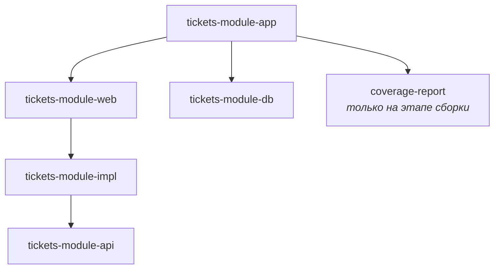

## 🛠 Технологии

| Технология                     | Назначение                                  |
|--------------------------------|---------------------------------------------|
| ☕ Java 17 + Spring Boot 3.2.5  | Основной язык и фреймворк                   |
| 🔐 Spring Security 6           | Сессии, JWT                                 |
| 🖼 Thymeleaf                   | Шаблонизатор для web-форм                   |
| 📦 Maven (wrapper)             | Многомодульная сборка                       |
| 🐘 PostgreSQL 13               | Основная база данных (через `compose.yaml`) |
| 🧪 JUnit 5 + Mockito + MockMvc | Юнит- и интеграционные тесты                |
| 📊 JaCoCo 0.8.11               | Покрытие кода                               |
| 🔍 SonarCloud                  | Анализ качества и Quality Gate              |
| 🐳 Docker Compose              | Локальный запуск БД и Redis                 |
| 📦 Testcontainers              | Подъём PostgreSQL для интеграционных тестов |
| 📄 OpenAPI Generator           | Генерация DTO и интерфейсов контроллеров    |
| 🏗 Dockerfile                  | Сборка образа для деплоя на Railway         |
| 🔄 MapStruct 1.5.5             | Генерация мапперов Entity ↔ DTO             |
| 🔴 Redis 7                    | Кэш купленных билетов пользователя          |


## 🚀 Быстрый старт

### ✅ Требования

| Требование | Версия / Примечание               |
|------------|-----------------------------------|
| ☕ JDK | 17+                               |
| 📦 Maven | или встроенный `./mvnw`           |
| 🐳 Docker + Docker Compose | для запуска БД и Redis         |


### 📥 Клонирование репозитория

```bash
git clone https://github.com/SokolovAndr/tickets-module.git
cd tickets-module
```

### 🐳 Запуск инфраструктуры

```bash
docker compose up -d
```

Поднимает два сервиса:
- `postgres` — порт 5454
- `redis` — порт 6379


### ▶️ Запуск приложения

#### Для локального запуска через IDEA необходимо:
1. создать environment variable "JWT_SECRET" в Run/Debug Configuration. Значение переменной нужно уточнить у автора.
2. Указать профиль: _local_
3. Запустить

#### Для локального запуска через терминал необходимо:
1. собрать приложение командой:

```
./mvnw clean package
# или
mvn clean package
```

2. запустить командой:

```cmd
$env:JWT_SECRET="ПОДСТАВИТЬ_ЗНАЧЕНИЕ_JWT_SECRET"
java -jar tickets-module-app/target/tickets-module-app-0.0.1-SNAPSHOT.jar --spring.profiles.active=local
```
Приложение по умолчанию будет доступно на http://localhost:8099.

### 🔨 Для полной сборки с интеграционными тестами и агрегированным отчётом JaCoCo:

```bash
./mvnw clean verify
```
Агрегированный отчёт будет доступен по пути:
coverage-report/target/site/jacoco/index.html

## ⚙️ Конфигурация

Проект поддерживает профили Spring:

| Профиль | Назначение |
|---------|-----------|
| `application-local.yml` | Локальная конфигурация |
| `application-railway.yml` | Конфигурация для деплоя на [Railway](https://railway.app/) |
| `application-test.yml` | Конфигурация для интеграционных тестов (PostgreSQL в Docker через Testcontainers) |

Интеграционные тесты (`*IT`) используют `Testcontainers`. 
При запуске тестов автоматически поднимается одноразовый контейнер PostgreSQL 13, миграции Liquibase накатываются на него, а после завершения — контейнер останавливается. 
Отдельно поднимать БД через `docker compose` для тестов не нужно — достаточно, чтобы был доступен Docker.

Redis подключается в профиле `application-local.yml`. В тестах кэш отключён (`spring.cache.type: none`).

## 🐳 Docker / Railway

Сборка образа:

```bash
docker build -t tickets-module .
```

Dockerfile использует multi-stage build:
1. **build** — `maven:3.9.6-eclipse-temurin-17`, кэширует зависимости (`dependency:go-offline`), собирает JAR.
2. **runtime** — `eclipse-temurin:17-jre-jammy`, запускает `tickets-module-app`.

## ⚠️ Ограничения Free-плана Railway

Приложение размещено на **бесплатном плане Railway (Free)**, поэтому производительность ограничена ресурсами хостинга, а не кодом:

- **CPU** — shared, с троттлингом под нагрузкой;
- **RAM** — ~512 МБ, часто приводит к частому GC и замедлению JVM;
- **Cold start** — приложение «засыпает» при простое, первый запрос долгий;
- **БД** — те же лимиты по CPU/RAM и количеству подключений;
- **Redis на Railway не подключён** — кэш отключён, запросы `GET /api/tickets/my` идут напрямую в PostgreSQL;

Как следствие: медленный старт, долгие ответы API, долгая загрузка web-страниц. Это ожидаемое поведение Free-плана, а не баг приложения.

## 🔐 Безопасность

В проекте используются две независимые цепочки Spring Security:

| Цепочка | Область                               | Механизм                            |
|---------|---------------------------------------|-------------------------------------|
| UI | /login, /register, статические ресурсы | Form login + HTTP-сессия            |
| REST API | /api/**                               | JWT Bearer (OAuth2 Resource Server) |

Для UI-цепочки текущий пользователь резолвится через SessionCurrentUserService, для REST — через JwtCurrentUserService.

## ⚡ Кэширование

Проект использует Redis для кэширования списка купленных билетов пользователя (в локальном профиле).

### Что кэшируется

- Метод `TicketsService.findAllMyTickets(userId)`.
- Endpoint `GET /api/tickets/my`.
- Один ключ на пользователя: `tickets:userTickets::<userId>`.

### Настройки

| Параметр | Значение |
|---|---|
| Сериализация | JSON (`GenericJackson2JsonRedisSerializer`) |
| TTL | 30 минут |
| Инвалидация | `@CacheEvict` на `buyTicket` и `returnTicket` |
| Fallback | `LoggingCacheErrorHandler` — при падении Redis метод идёт в Postgres |

> ℹ️ Кэш активен только в профиле `local`. На Railway Redis не развёрнут, поэтому метод уходит в PostgreSQL.

### Проверка

```bash
docker exec -it tickets-module-redis redis-cli keys "tickets:*"
docker exec -it tickets-module-redis redis-cli ttl "tickets:userTickets::<userId>"
docker exec -it tickets-module-redis redis-cli get "tickets:userTickets::<userId>"

```

## 🧪 Тестирование

| Тип тестов           | Плагин   | Инфраструктура              | Расположение                                             |
|----------------------|----------|-----------------------------|----------------------------------------------------------|
| Юнит-тесты           | Surefire | без внешних зависимостей    | */src/test/java (классы *Test)                           |
| Интеграционные тесты | Failsafe | Testcontainers (PostgreSQL) | tickets-module-app/src/test/java, классы с суффиксом *IT |

### Запуск только юнит-тестов:

```bash
./mvnw test
```
### Запуск всех тестов (юнит + интеграционные):

```bash
./mvnw verify
```

## 📊 Покрытие кода

Проект использует агрегированный отчёт JaCoCo — отчёты со всех модулей собираются в coverage-report:
```bash
./mvnw verify
```
SonarCloud использует агрегированный отчёт через параметр:
sonar.coverage.jacoco.aggregateXmlReportPaths=coverage-report/target/site/jacoco/jacoco.xml

## 📖 Архитектурные решения

Ключевые решения зафиксированы в [ADR](docs/adr/):
- [0001 — Разбиение на Maven-модули](docs/adr/0001-multimodule-structure.md)
- [0002 — JPA-сущности как доменные модели](docs/adr/0002-jpa-as-domain.md)
- [0003 — Две цепочки Security: session + JWT](docs/adr/0003-jwt-and-sessions.md)
- [0004 — Redis для кэша купленных билетов](docs/adr/0004-caching-strategy.md)
- [0005 — Отклонение от правила web → impl](docs/adr/0005-web-impl-coupling.md)

## 👤 Автор

**SokolovAndr** — [GitHub](https://github.com/SokolovAndr)

---

> ⚠️ Проект находится в активной разработке. UI, API и структура могут меняться.
